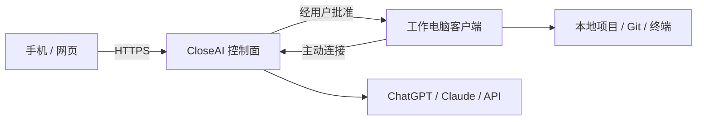

  
  <h1>CloseAI 助手</h1>
  
<strong>电脑在工作，你可以在任何地方。</strong>

  
从电脑、网页、手机，或 VS Code / IntelliJ IDEA 插件指挥 AI 操作自己的开发环境。

**中文** · [English](README_EN.md) · [在线工作台](https://closeai.shop)

> CloseAI 是采用订阅制的闭源商业软件。本仓库是公开发布仓库，只提供产品说明、安装文档和官方二进制安装包，不包含 CloseAI 源代码。

## IDE 插件与项目资料

**支持 VS Code 和 IntelliJ IDEA 插件使用**：在编辑器里继续当前工程的聊天、选择模型和推理强度、查看额度，并按权限执行项目任务。与网页、桌面和手机共用同一 CloseAI 账号。

| 入口                                                                                                  | 当前状态                                                              |
| ----------------------------------------------------------------------------------------------------- | --------------------------------------------------------------------- |
| VS Code 1.99+ | [GitHub 0.2.2 VSIX](https://github.com/unfalltable/closeai/releases/download/v0.1.0-beta.19/closeai-workbench-0.2.2.vsix) · [Marketplace](https://marketplace.visualstudio.com/items?itemName=unfalltable.closeai-workbench) |
| IntelliJ IDEA 2026.1 / JCEF | [GitHub 0.2.2 ZIP](https://github.com/unfalltable/closeai/releases/download/v0.1.0-beta.19/closeai-workbench-0.2.2-jetbrains.zip) · [Marketplace](https://plugins.jetbrains.com/plugin/35310-closeai-assistant) |
| [网页工作台](https://closeai.shop)                                                                    | 支持附件与项目 ZIP 上传；单文件最高 **5 GiB**，受账号剩余存储空间限制 |

打开本机工程 → 浏览器登录授权 → 确认当前目录 → 选择模型与权限开始聊天。新用户可前往官网添加或购买模型账号，再返回插件刷新。大目录先在本地打包为 ZIP；已有源码也可通过 IDE 或 Git 直接连接。

[插件安装与使用、大文件和整项目分析指南](docs/IDE_PLUGINS.md)

## 下载：选哪个安装包？

GitHub 当前版本：**[0.1.0-beta.19](https://github.com/unfalltable/closeai/releases/tag/v0.1.0-beta.19)**，更新日期 **2026-11-03**。桌面、Android 和 iOS 模拟器包已重新构建；IDE 离线插件为 **0.2.2**。历史 Release 保留归档，新安装请选择下表。

| 你的设备 | 下载 | 版本与状态 |
| --- | --- | --- |
| Windows 10/11，Intel / AMD 64 位 | [Windows `.exe`](https://github.com/unfalltable/closeai/releases/download/v0.1.0-beta.19/CloseAI-0.1.0-beta.19-Windows-x64.exe) | **0.1.0-beta.19**；未代码签名，可能出现 SmartScreen 提示 |
| Mac，Apple 芯片（M 系列） | [Apple 芯片 `.dmg`](https://github.com/unfalltable/closeai/releases/download/v0.1.0-beta.19/CloseAI-0.1.0-beta.19-macOS-arm64.dmg) / [`.zip`](https://github.com/unfalltable/closeai/releases/download/v0.1.0-beta.19/CloseAI-0.1.0-beta.19-macOS-arm64.zip) | **0.1.0-beta.19**；macOS **13.5+**，已签名、公证、装订并通过 Gatekeeper 校验 |
| Mac，Intel 处理器 | [Intel `.dmg`](https://github.com/unfalltable/closeai/releases/download/v0.1.0-beta.19/CloseAI-0.1.0-beta.19-macOS-x64.dmg) / [`.zip`](https://github.com/unfalltable/closeai/releases/download/v0.1.0-beta.19/CloseAI-0.1.0-beta.19-macOS-x64.zip) | **0.1.0-beta.19**；macOS **13.5+**，已签名、公证、装订并通过 Gatekeeper 校验 |
| Linux，Intel / AMD 64 位 | [Debian / Ubuntu `.deb`](https://github.com/unfalltable/closeai/releases/download/v0.1.0-beta.19/CloseAI-0.1.0-beta.19-Linux-amd64.deb) / [`.AppImage`](https://github.com/unfalltable/closeai/releases/download/v0.1.0-beta.19/CloseAI-0.1.0-beta.19-Linux-x86_64.AppImage) / [便携 `.tar.gz`](https://github.com/unfalltable/closeai/releases/download/v0.1.0-beta.19/CloseAI-0.1.0-beta.19-Linux-x86_64.tar.gz) | **0.1.0-beta.19**；需要系统桌面运行库 |
| Android | [测试 `.apk`](https://github.com/unfalltable/closeai/releases/download/v0.1.0-beta.19/CloseAI-0.1.0-beta.19-Android-debug.apk) | **0.1.0-beta.19**；调试签名，仅供侧载测试，非 Google Play 正式版 |
| iPhone / iPad | [Safari 网页版 / 添加到主屏幕](https://closeai.shop) | 正式 iOS 发布保持暂停，本次未上传 IPA、TestFlight 或 App Store |
| iOS 开发者（Mac） | [iOS Simulator `.app.zip`](https://github.com/unfalltable/closeai/releases/download/v0.1.0-beta.19/CloseAI-0.1.0-beta.19-iOS-Simulator.app.zip) | 本次重新构建；仅模拟器，**不能安装到 iPhone / iPad**；原生内部版本 0.1.0（2） |
| VS Code 1.99+ | [离线 `.vsix`](https://github.com/unfalltable/closeai/releases/download/v0.1.0-beta.19/closeai-workbench-0.2.2.vsix) | **0.2.2**；Extensions → Install from VSIX |
| IntelliJ IDEA 2026.1（JCEF） | [离线插件 `.zip`](https://github.com/unfalltable/closeai/releases/download/v0.1.0-beta.19/closeai-workbench-0.2.2-jetbrains.zip) | **0.2.2**；Settings → Plugins → Install Plugin from Disk |
| Linux 服务器 | [安装脚本](https://github.com/unfalltable/closeai/releases/download/v0.1.0-beta.19/install-closeai-server.sh) / [连接器](https://github.com/unfalltable/closeai/releases/download/v0.1.0-beta.19/closeai-server-connector.cjs) | 与本次发布源码同步；脚本固定下载本 Release 的连接器，Node.js 20+ |
| 浏览器 / PWA | [直接打开工作台](https://closeai.shop) | 无需安装；操作项目时，连接的电脑或服务器需在线 |

Mac 架构可在 ** → 关于本机** 查看：“芯片”选 Apple 芯片版，“处理器 Intel”选 Intel 版。普通安装优先 `.dmg`。IDE 商店版本独立发布，本次仅更新 GitHub 离线包。

每个安装包均有同名 `.sha256`；也可下载 [SHA256SUMS.txt](https://github.com/unfalltable/closeai/releases/download/v0.1.0-beta.19/SHA256SUMS.txt) 和 [release-manifest.json](https://github.com/unfalltable/closeai/releases/download/v0.1.0-beta.19/release-manifest.json) 核对文件、版本和来源。校验与升级步骤见[安装指南](docs/INSTALLATION.md)。桌面自动更新仍使用官网独立更新渠道；本 Release 提供手动下载。GitHub 自动生成的 **Source code (zip / tar.gz)** 只是公开文档仓库快照，**不是客户端安装包，也不含产品源码**。

## 使用流程

1. 注册并登录 CloseAI。
2. 订阅基础服务，然后选择 ChatGPT 官方登录、Claude API Key、OpenAI API Key，或申请额外付费的 CloseAI 托管账号。
3. 在工作电脑安装 CloseAI，使用一次性配对码连接设备并选择允许访问的项目目录。
4. 在工作台选择项目、在线电脑、模型账号和模型，然后发送任务。
5. AI 请求写文件、运行命令或执行 Git 操作时，由你确认后才会在工作电脑执行。
6. 工作电脑保持开机在线时，可以从手机、网页或其他电脑继续同一会话。

## 主要能力

- 管理本地项目、文件、终端命令和 Git 操作。
- 支持 ChatGPT 官方授权、Claude、OpenAI API Key 和平台托管账号。
- 用户记忆、项目记忆和会话统一保存在 CloseAI 账号下，切换模型账号后仍可继续。
- 每个 CloseAI 用户使用独立运行容器和数据卷。
- 桌面、网页、PWA 和 Android 共用同一会话。
- 支持多台工作电脑和跨电脑 Git 工作流。

CloseAI 不默认托管完整代码仓库。源码保存在你的工作电脑或自己的 Git 远端；发送给模型服务的上下文受相应模型服务商条款约束。

## 安全说明

- 平台账号、模型账号和设备配对凭证相互独立。
- 文件写入、命令和 Git 操作需要用户批准。
- 同一运行节点上的用户容器可能共享公网出口 IP；需要独立出口时应使用不同网络线路的运行节点。
- 模型可用地区、账号状态和服务规则由对应服务商决定。
- 请勿在公开 Issue 中提交密码、Cookie、API Key、服务器凭证、个人信息或用户代码。

## 反馈与支持

普通问题可以使用 [GitHub Issues](https://github.com/unfalltable/closeai/issues)。安全问题请按[安全策略](SECURITY.md)私下报告。

## 许可

CloseAI 为专有商业软件。下载和使用官方客户端代表你同意 [CloseAI 专有商业许可](LICENSE)以及适用的订阅或订单条款。
