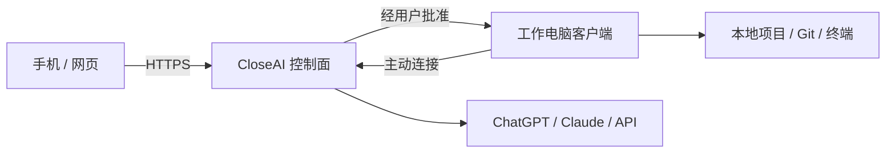

  
  <h1>CloseAI 助手</h1>
  
<strong>电脑在工作，你可以在任何地方。</strong>

  
从电脑、网页、手机，或 VS Code / IntelliJ IDEA 插件指挥 AI 操作自己的开发环境。

**中文** · [English](README_EN.md) · [在线工作台](https://closeai.shop)

> CloseAI 是采用订阅制的闭源商业软件。本仓库是公开发布仓库，只提供产品说明、安装文档和官方二进制安装包，不包含 CloseAI 源代码。

## IDE 插件与项目资料

**支持 VS Code 和 IntelliJ IDEA 插件使用**：在编辑器里继续当前工程的聊天、选择模型和推理强度、查看额度，并按权限执行项目任务。与网页、桌面和手机共用同一 CloseAI 账号。

| 入口                                                                                                  | 当前状态                                                              |
| ----------------------------------------------------------------------------------------------------- | --------------------------------------------------------------------- |
| [VS Code 插件安装](https://marketplace.visualstudio.com/items?itemName=unfalltable.closeai-workbench) | **0.2.1 已公开可安装**，VS Code 1.99+                                 |
| [IntelliJ IDEA 插件页面](https://plugins.jetbrains.com/plugin/35310-closeai-assistant)                | **0.2.0 市场审核中**，IDEA 2026.1 系列；尚未开放市场安装              |
| [网页工作台](https://closeai.shop)                                                                    | 支持附件与项目 ZIP 上传；单文件最高 **5 GiB**，受账号剩余存储空间限制 |

打开本机工程 → 浏览器登录授权 → 确认当前目录 → 选择模型与权限开始聊天。新用户可前往官网添加或购买模型账号，再返回插件刷新。大目录先在本地打包为 ZIP；已有源码也可通过 IDE 或 Git 直接连接。

[插件安装与使用、大文件和整项目分析指南](docs/IDE_PLUGINS.md)

## 下载：选哪个安装包？

**普通用户从[官网下载页](https://closeai.shop)选择平台即可。** 当前 Windows / Mac 推荐版在官网分发；GitHub Releases 中的 beta.1、beta.2 是历史测试包，不代表官网当前版本。

信息核对日期：**2026-10-19**，后续版本以官网下载页为准。

| 你的设备                         | 推荐下载                                                                                                                                                                                                                                                                  | 版本与状态                                                                                        |
| -------------------------------- | ------------------------------------------------------------------------------------------------------------------------------------------------------------------------------------------------------------------------------------------------------------------------- | ------------------------------------------------------------------------------------------------- |
| Windows 10/11，64 位 Intel / AMD | [Windows 安装程序 `.exe`](https://closeai.shop/desktop-releases/CloseAI%20%E5%8A%A9%E6%89%8B-0.1.0-beta.17-Windows-x64.exe)                                                                                                                                               | **0.1.0-beta.17**；暂未 Windows 代码签名，可能出现 SmartScreen 提示                               |
| Mac，Apple 芯片（M 系列）        | [Apple 芯片 `.dmg`](https://closeai.shop/desktop-releases/CloseAI%20%E5%8A%A9%E6%89%8B-0.1.0-beta.17-macOS-arm64.dmg)                                                                                                                                                     | **0.1.0-beta.17**；macOS **13.5+**，已签名、公证及装订，通过 Gatekeeper 校验                      |
| Mac，Intel 处理器                | [Intel `.dmg`](https://closeai.shop/desktop-releases/CloseAI%20%E5%8A%A9%E6%89%8B-0.1.0-beta.17-macOS-x64.dmg)                                                                                                                                                            | **0.1.0-beta.17**；macOS **13.5+**，已签名、公证及装订，通过 Gatekeeper 校验                      |
| Linux，64 位 Intel / AMD         | [Debian / Ubuntu `.deb`](https://github.com/unfalltable/closeai/releases/download/v0.1.0-beta.2/CloseAI-0.1.0-beta.2-Linux-amd64.deb) / [便携 `.tar.gz`](https://github.com/unfalltable/closeai/releases/download/v0.1.0-beta.2/CloseAI-0.1.0-beta.2-Linux-x86_64.tar.gz) | **0.1.0-beta.2** 历史测试版；未与当前 Windows / Mac 同步发包                                      |
| Android 7+                       | [测试 `.apk`](https://github.com/unfalltable/closeai/releases/download/v0.1.0-beta.2/CloseAI-0.1.0-beta.2-Android-debug.apk)                                                                                                                                              | **0.1.0-beta.2** 历史测试版；调试签名，仅供侧载测试，非 Google Play 正式版                        |
| iPhone / iPad                    | [Safari 网页版 / 添加到主屏幕](https://closeai.shop)                                                                                                                                                                                                                      | 原生 **1.0.0（120）** 已提供 TestFlight 内测；仅限已获邀请的测试者，**尚未在 App Store 公开上架** |
| 浏览器 / PWA                     | [直接打开工作台](https://closeai.shop)                                                                                                                                                                                                                                    | 无需下载安装包；操作项目时，连接的电脑或服务器仍需在线                                            |

不确定 Mac 架构时，打开 ** → 关于本机**：“芯片”选 Apple 芯片版，“处理器 Intel”选 Intel 版。`arm64` 与 `x64` 不是两个不同功能版本。

### Release 里其他文件是什么？

| 文件                                             | 需不需要下载？                                                     |
| ------------------------------------------------ | ------------------------------------------------------------------ |
| `.exe`、`.dmg`、`.deb`、`.apk`                   | 对应平台的安装包，按上表选择一个                                   |
| Linux `.tar.gz` / 旧版 `.AppImage`               | Linux 的其他打包方式；旧版 AppImage 仅作历史存档                   |
| Mac `.zip` / 旧版 `.app.zip`                     | 应用压缩包；普通用户优先选当前 `.dmg`，beta.2 的未签名旧包不再推荐 |
| `.sha256` / `SHA256SUMS-*.txt`                   | 校验文件，用于确认下载完整性，不是安装包                           |
| `latest-*.json` / `.squirrel.json` 等更新元数据  | 由客户端更新程序使用，不用手动安装                                 |
| GitHub 自动生成的 **Source code (zip / tar.gz)** | 本公开文档仓库的快照，**不是客户端安装包，也不包含产品源码**       |

官网 Windows / Mac 安装包旁有同名 `.sha256` 文件；Linux 使用所在 Release 的 `SHA256SUMS-closeai-linux.txt`。安装、校验和升级步骤见[安装指南](docs/INSTALLATION.md)。

## 使用流程

1. 注册并登录 CloseAI。
2. 订阅基础服务，然后选择 ChatGPT 官方登录、Claude API Key、OpenAI API Key，或申请额外付费的 CloseAI 托管账号。
3. 在工作电脑安装 CloseAI，使用一次性配对码连接设备并选择允许访问的项目目录。
4. 在工作台选择项目、在线电脑、模型账号和模型，然后发送任务。
5. AI 请求写文件、运行命令或执行 Git 操作时，由你确认后才会在工作电脑执行。
6. 工作电脑保持开机在线时，可以从手机、网页或其他电脑继续同一会话。

## 主要能力

- 管理本地项目、文件、终端命令和 Git 操作。
- 支持 ChatGPT 官方授权、Claude、OpenAI API Key 和平台托管账号。
- 用户记忆、项目记忆和会话统一保存在 CloseAI 账号下，切换模型账号后仍可继续。
- 每个 CloseAI 用户使用独立运行容器和数据卷。
- 桌面、网页、PWA 和 Android 共用同一会话。
- 支持多台工作电脑和跨电脑 Git 工作流。

CloseAI 不默认托管完整代码仓库。源码保存在你的工作电脑或自己的 Git 远端；发送给模型服务的上下文受相应模型服务商条款约束。

## 安全说明

- 平台账号、模型账号和设备配对凭证相互独立。
- 文件写入、命令和 Git 操作需要用户批准。
- 同一运行节点上的用户容器可能共享公网出口 IP；需要独立出口时应使用不同网络线路的运行节点。
- 模型可用地区、账号状态和服务规则由对应服务商决定。
- 请勿在公开 Issue 中提交密码、Cookie、API Key、服务器凭证、个人信息或用户代码。

## 反馈与支持

普通问题可以使用 [GitHub Issues](https://github.com/unfalltable/closeai/issues)。安全问题请按[安全策略](SECURITY.md)私下报告。

## 许可

CloseAI 为专有商业软件。下载和使用官方客户端代表你同意 [CloseAI 专有商业许可](LICENSE)以及适用的订阅或订单条款。
